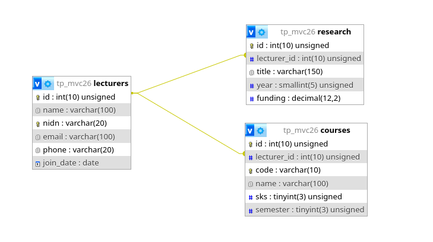

# Janji
Saya Muhammad Rian Anugrah dengan NIM 2507241 mengerjakan Tugas Praktikum 8 pada Mata Kuliah Desain dan Pemrograman Berorientasi Objek (DPBO) untuk keberkahan-Nya maka saya tidak melakukan kecurangan seperti yang telah dispesifikasikan. Aamiin

# Fitur Utama

Aplikasi ini mendukung fungsionalitas CRUD (Create, Read, Update, Delete) penuh untuk tiga entitas utama:

* **CRUD Lecturers:** Menambah, melihat, mengubah, dan menghapus data dosen.
* **CRUD Courses:** Menambah, melihat, mengubah, dan menghapus data mata kuliah.
* **CRUD Research:** Menambah, melihat, mengubah, dan menghapus data penelitian dosen.

## Relasi Database
* **Lecturers ke Courses (1-N):** Satu dosen dapat mengampu banyak mata kuliah.
* **Lecturers ke Research (1-N):** Satu dosen dapat memiliki banyak penelitian.
  

# Struktur Arsitektur MVC

Proyek ini dibagi menjadi tiga komponen utama (Model, View, Controller) dan satu Router utama.

* **`Program/public/index.php` (Router Utama / Front Controller)**
    * File ini adalah satu-satunya gerbang masuk untuk semua permintaan pengguna.
    * Tugasnya membaca parameter `?page=` dan `?action=` dari URL.
    * Berdasarkan URL, router memuat file Controller yang sesuai dan memanggil method (action) yang diminta.

* **`Program/app/models/` (Model)**
    * Bertanggung jawab untuk seluruh interaksi dan manipulasi data ke database MySQL menggunakan PDO.
    * `Lecturer.php`: Berisi query SQL untuk CRUD tabel `lecturers`.
    * `Course.php`: Berisi query SQL untuk CRUD tabel `courses` (termasuk JOIN ke tabel `lecturers`).
    * `Research.php`: Berisi query SQL untuk CRUD tabel `research` (termasuk JOIN ke tabel `lecturers`).

* **`Program/app/controllers/` (Controller)**
    * Bertindak sebagai penghubung logika antara Model dan View.
    * `LecturerController.php`: Mengatur logika alur untuk menampilkan, menambah, mengubah, dan menghapus data dosen.
    * `CourseController.php`: Mengatur logika CRUD mata kuliah serta mengambil data dosen untuk dropdown pengampu.
    * `ResearchController.php`: Mengatur logika CRUD penelitian serta mengambil data dosen untuk dropdown peneliti.

* **`Program/app/views/` (View)**
    * Bertanggung jawab untuk tampilan antarmuka (UI) yang disajikan kepada pengguna menggunakan Bootstrap.
    * `header.php` & `footer.php`: Template layout utama (navbar responsif, container, notifikasi flash, dan script Bootstrap).
    * `lecturers/`, `courses/`, `research/`: Masing-masing modul memiliki subfolder tampilan yang terdiri dari:
        1. `index.php` (Tabel daftar data)
        2. `create.php` (Halaman form tambah data)
        3. `edit.php` (Halaman form ubah data)
        4. `_form.php` (Komponen form reusable)

* **`Program/app/core/` (Core Engine)**
    * `Config.php`: Mengatur konstanta aplikasi, konfigurasi kredensial database, dan perhitungan dinamis `BASE_URL`.
    * `Database.php`: Kelas singleton penyedia koneksi PDO dengan prepared statements yang aman.

# Struktur Proyek

Proyek ini menggunakan arsitektur MVC (Model-View-Controller) dengan struktur folder berikut:

```
TP8DPBO2526C2/
├── Dokumentasi/
│   ├── Diagram.png
│   └── record.mp4
│
├── Program/
│   ├── app/
│   │   ├── controllers/
│   │   │   ├── CourseController.php
│   │   │   ├── LecturerController.php
│   │   │   └── ResearchController.php
│   │   │
│   │   ├── core/
│   │   │   ├── Config.php
│   │   │   └── Database.php
│   │   │
│   │   ├── models/
│   │   │   ├── Course.php
│   │   │   ├── Lecturer.php
│   │   │   └── Research.php
│   │   │
│   │   └── views/
│   │       ├── courses/
│   │       │   ├── _form.php
│   │       │   ├── create.php
│   │       │   ├── edit.php
│   │       │   └── index.php
│   │       ├── lecturers/
│   │       │   ├── _form.php
│   │       │   ├── create.php
│   │       │   ├── edit.php
│   │       │   └── index.php
│   │       ├── research/
│   │       │   ├── _form.php
│   │       │   ├── create.php
│   │       │   ├── edit.php
│   │       │   └── index.php
│   │       ├── footer.php
│   │       └── header.php
│   │
│   ├── database/
│   │
│   └── public/
│       ├── assets/
│       │   ├── css/
│       │   │   └── bootstrap.min.css
│       │   └── js/
│       │       └── bootstrap.bundle.min.js
│       └── index.php
│
├── tp_mvc26.sql
└── README.md
```

# Diagram


# Database

Aplikasi menggunakan database bernama **`tp_mvc26`** yang skema dan datanya tersimpan di file **`tp_mvc26.sql`**. Struktur database terdiri dari tiga tabel utama yang saling berelasi:

* **Tabel `lecturers`**: Menyimpan identitas dosen pengajar (id, name, nidn, email, phone, join_date).
* **Tabel `courses`**: Menyimpan kurikulum mata kuliah (id, lecturer_id, code, name, sks, semester), berelasi ke tabel `lecturers` (`ON DELETE SET NULL`).
* **Tabel `research`**: Menyimpan data penelitian dosen (id, lecturer_id, title, year, funding), berelasi ke tabel `lecturers` (`ON DELETE SET NULL`).

# Dokumentasi
https://github.com/user-attachments/assets/edc0a627-89ab-4a09-86aa-5ef103ce15f3
